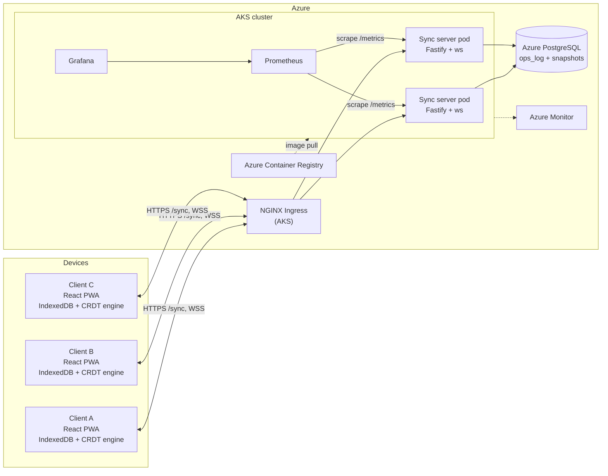
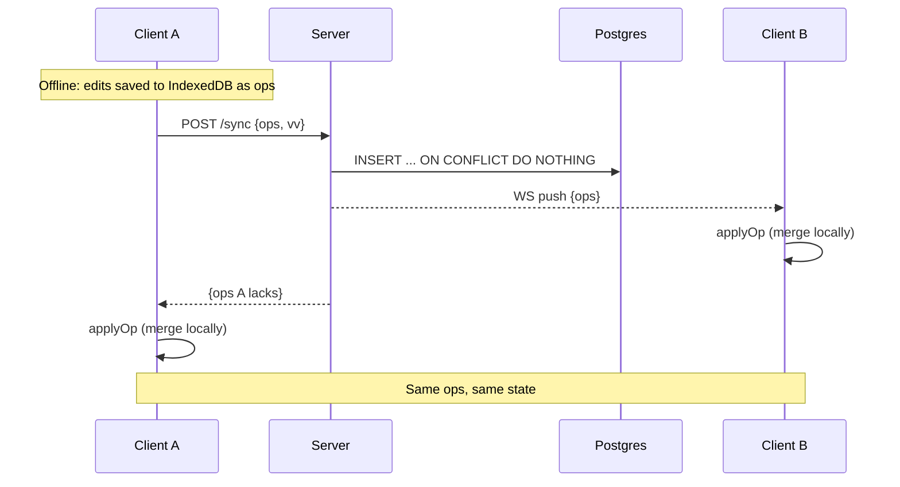

# SyncList Architecture

## System overview

## Sync flow (offline edit, then reconnect)

## Key points
- Clients merge. The server only stores and relays ops.
- Two server pods: any pod can serve any client, since all state is in Postgres.
- Cross-pod WebSocket broadcast needs a mechanism (Postgres `LISTEN/NOTIFY`). Planned for Phase 4.